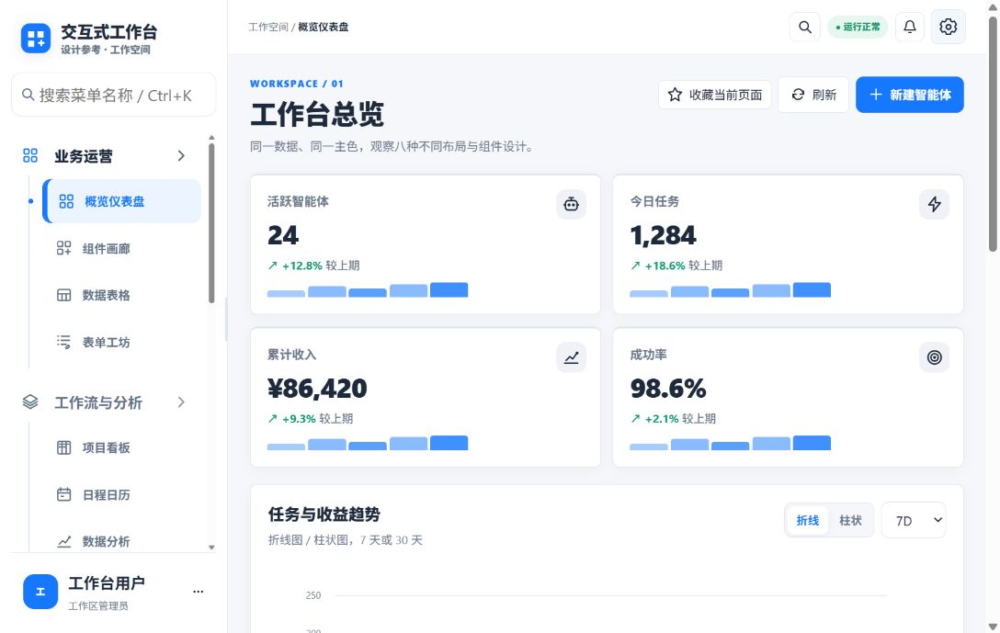
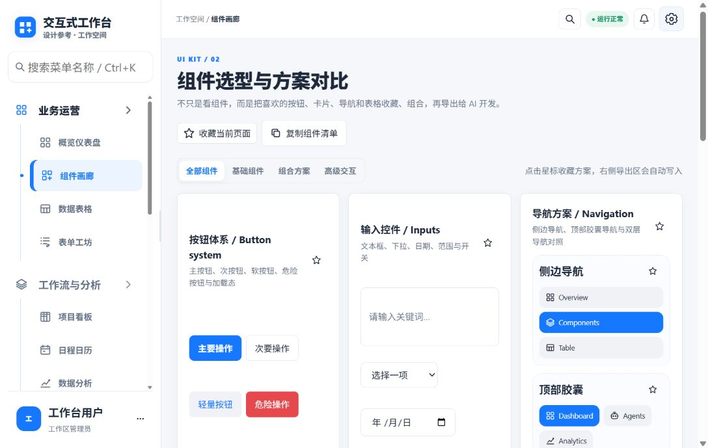
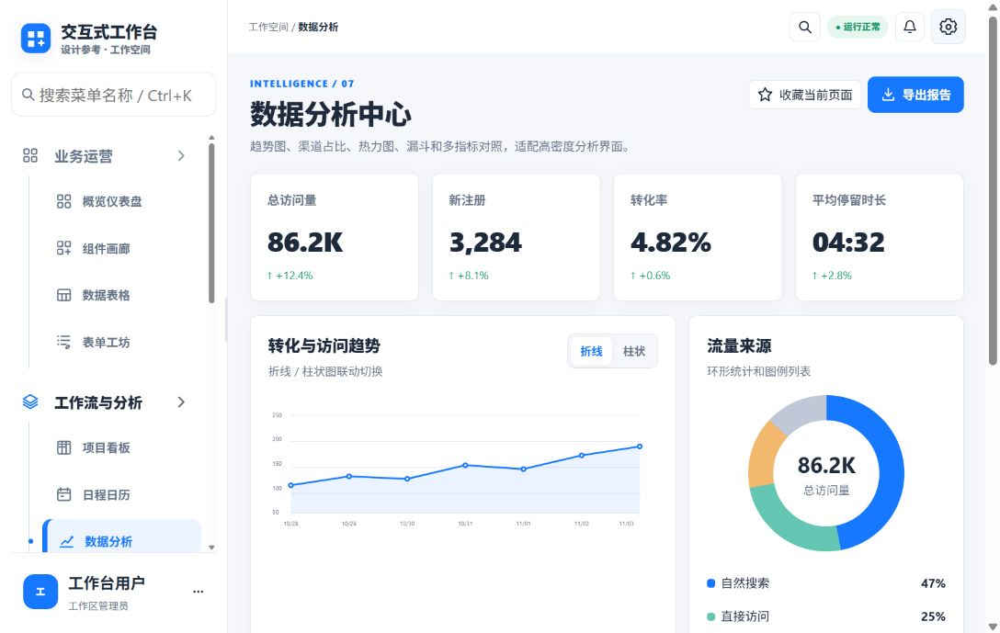
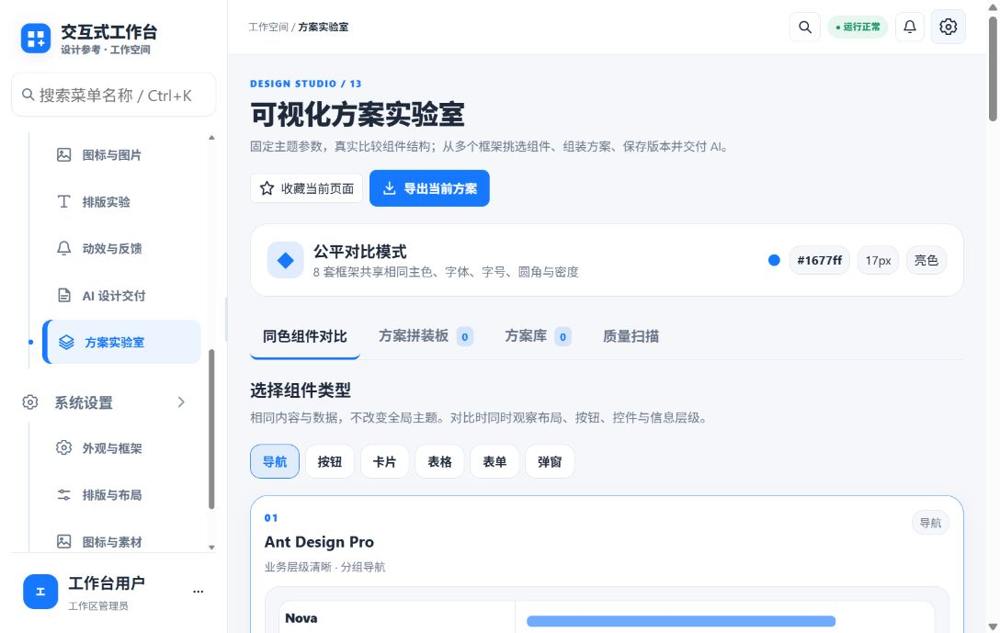

<div align="center">

# Interactive Workbench

### 把分散的界面灵感，整理成可比较、可组合、可交付的设计方案。

一个面向产品、设计与研发协作的交互式工作台原型。



<p>
  <strong>看全局</strong> · <strong>比方案</strong> · <strong>做交付</strong>
</p>

</div>

## 项目价值

设计评审常常卡在“感觉不错”或“这个组件应该更紧凑”这样的口头讨论。Interactive Workbench 把关键决策放进一个可操作的界面：统一颜色、字体、圆角和密度，再并排比较不同组件结构，选出需要的版本，最后把结果整理成 AI 与研发都能继续使用的交付资料。

它的价值在于**把视觉讨论变成有上下文的选择**：团队可以看到同一组数据放进不同布局后的差异，及时发现信息层级、阅读顺序和空间密度的问题，再将确认的选择带入下一步实现。它是一套可浏览、可交互的前端原型和设计探索工具；不代表已连接真实业务数据或具备服务端协作能力。

## 从观察到交付

| 工作环节 | 工作台里的对应能力 | 解决的问题 |
| --- | --- | --- |
| 浏览场景 | 仪表盘、看板、日历、表格和分析页面 | 用真实任务视图讨论，而不是只看孤立控件 |
| 对比选项 | 组件画廊与方案实验室 | 在相同主题和内容条件下比较不同结构 |
| 固定规则 | 外观、布局、图标、字体与 AI 交付设置 | 将颜色、字号、圆角和密度作为共享变量 |
| 形成方案 | 收藏、组合、保存、比较与导入导出 | 保留评审结论，让后续迭代有据可循 |
| 交给实现 | Markdown、JSON 与提示词交付 | 让设计意图进入研发或 AI 编码流程 |

## 界面一览

### 1. 工作台总览：把状态和趋势放在一起


总览页把活跃智能体、今日任务、收入、成功率、趋势图和运行列表放进同一视野。适合团队快速判断当前工作状态，并定位需要继续查看的项目。

### 2. 组件画廊：比较组件形态与交互



组件画廊覆盖按钮、输入控件、导航、卡片、表格和反馈状态。组件分类与收藏交互可以帮助评审从“选一个喜欢的样式”继续到“这个方案由哪些部分组成”。

### 3. 数据分析：让指标拥有对比和上下文



分析页面把趋势、流量来源、活动热力与转化路径放在一起，演示如何组织高密度信息。截图里的数字和记录均为界面演示数据。

### 4. 方案实验室：在统一条件下做公平比较



方案实验室支持在共同主题条件下查看多种框架风格，采用组件并逐步组合方案。设计师可以减少因主色、字号或圆角变化造成的干扰，集中讨论布局和表达本身。

## 主要能力

- **17 个工作视图**：覆盖仪表盘、组件、表格、表单、看板、日历、分析、智能体、素材、排版、动效和交付设置。
- **可交互的组件样例**：包含按钮、输入、筛选、确认弹窗、进度、表格、通知与状态反馈。
- **多种布局对比**：在统一内容与主题变量下浏览不同的信息层级和组件组织方式。
- **可保存的本地方案**：在当前浏览器创建、更新、载入、比较、导入与导出方案。
- **AI 设计交付**：把确认后的页面、组件、视觉规则和设计说明整理成 Markdown、JSON 或提示词。
- **适配不同屏幕**：侧边导航、页面栅格和组件会随窄屏调整。

## 本地运行

工作台是无需构建步骤的静态前端。建议通过本地 HTTP 服务访问：

```powershell
python -m http.server 8000
```

然后打开 `http://localhost:8000/`。

演示账号：`demo`  
演示密码：`Demo@2026`

演示账号仅用于界面体验。账号数据与方案保存在浏览器本地存储中；项目没有服务端认证、云端同步或真实业务 API，不能把当前登录页当作生产环境的身份验证。

## 目录结构

```text
.
├── index.html                    # 工作台入口
├── workbench.css                 # 页面样式与响应式布局
├── workbench.js                  # 交互、组件与页面状态
├── Interactive_Workbench_V1.0.html # 单文件分发版
├── docs/screenshots/             # 实际界面截图
└── workbench-showcase/           # 交互式工作台产品展示页与源码下载入口
```

## 交互式工作台展示站点

配套的 Codex Site 现已改为展示 Interactive Workbench 本身：工作台截图、17 个工作视图、8 种 UI 框架、主题色与密度预览、方案比较和 AI 交付能力都以本仓库内容为准。首屏提供 GitHub 开源项目跳转和仓库源码 ZIP 下载。

**展示页源码：** [`workbench-showcase/`](workbench-showcase/README.md)  
**GitHub 开源项目：** [wuwenlong1985/Interactive_Workbench](https://github.com/wuwenlong1985/Interactive_Workbench)  
**源码 ZIP：** [下载 main 分支](https://github.com/wuwenlong1985/Interactive_Workbench/archive/refs/heads/main.zip)

**Codex Site：** [Interactive Workbench 展示页](https://interactive-workbench-showcase.wuwenlong1985123.chatgpt.site)

## 技术与边界

- 原生 HTML、CSS 与 JavaScript，无构建链和外部运行依赖。
- 页面数据以演示样例为主，刷新后可能回到初始状态。
- 账号与工作台项目保存在浏览器 `localStorage`，清除站点数据会移除本地方案。
- 单文件 HTML 方便预览和分享；模块化源码更便于持续修改。
- 项目由 MIT 许可证发布，详见 [`LICENSE`](LICENSE)。

## 本地开发

页面不需要安装依赖。修改 `workbench.css` 或 `workbench.js` 后刷新浏览器即可查看。

