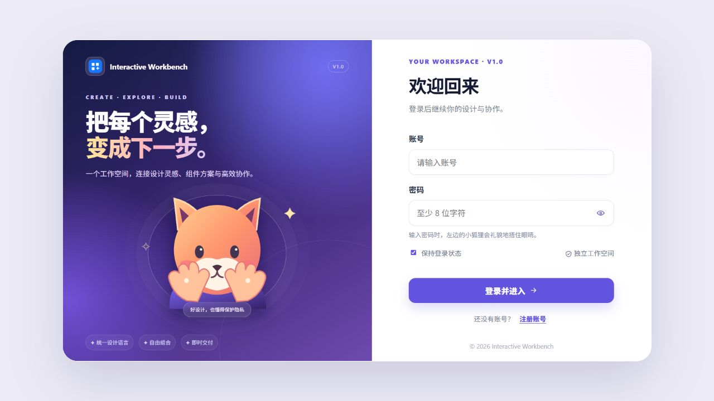

<div align="center">


# 交互式工作台·龙哥很忙

### 把界面灵感变成可比较、可组合、可交付的设计决定

一个面向产品、设计与研发协作的交互式前端工作台。用同一份真实内容比较不同框架、主题颜色和信息密度，再将确认的设计方案交给 AI 与研发继续实现。

[🌐 打开官网体验](https://interactive-workbench-showcase.wuwenlong1985123.chatgpt.site/) · [🧭 直接打开工作台预览](https://interactive-workbench-showcase.wuwenlong1985123.chatgpt.site/Interactive_Workbench_V1.0.html?demo=1) · [⬇️ 下载 GitHub 源码 ZIP](https://github.com/wuwenlong1985/Interactive_Workbench/archive/refs/heads/main.zip)

**17 个工作视图**　·　**8 种界面体系**　·　**7 档信息密度**　·　**MIT License**

</div>

> 封面为品牌氛围插画；下方界面图均为工作台实际页面截图。官网现已开放公开访问，不要求 GPT 登录。

## 为什么做这个工作台

设计评审经常停留在“感觉更紧凑一些”或“换个框架试试”的口头沟通。工作台把讨论变成可见、可操作的比较：统一内容与主题变量，直接检查框架结构、组件状态、颜色与密度如何影响阅读，再收藏和组合选中的设计方案。

它让团队更快回答三个问题：

- **看清差异**：同一内容放到不同布局中，层级和阅读顺序有什么变化？
- **固定决定**：颜色、字号、圆角、图标和密度哪些需要保留？
- **推进实现**：怎样把评审结论交给 AI 或研发，减少重复解释？

项目目前是可在浏览器运行的前端原型。页面使用演示数据，本地保存账号与方案；它没有服务端认证、云端同步或真实业务数据连接。

## 实际界面

<table>
  <tr>
    <td width="50%"><br><strong>01 · 工作台总览</strong><br>状态指标、趋势和近期任务集中呈现。</td>
    <td width="50%"><br><strong>02 · 组件画廊</strong><br>对照常用控件、导航与交互反馈。</td>
  </tr>
  <tr>
    <td width="50%"><br><strong>03 · 数据分析中心</strong><br>通过趋势、构成与转化路径组织信息。</td>
    <td width="50%"><br><strong>04 · 方案实验室</strong><br>在统一主题条件下比较布局和组件组合。</td>
  </tr>
  <tr>
    <td colspan="2"><br><strong>05 · 登录与欢迎页</strong><br>品牌欢迎区、狐狸插画和登录表单构成首次进入体验。官网预览会预填体验账号；账号仅用于前端演示，不代表真实身份验证。</td>
  </tr>
</table>

## 能力一览

| 评审阶段 | 工作台能力 | 设计价值 |
| --- | --- | --- |
| 浏览场景 | 总览、表格、表单、看板、日历、分析等 17 个工作视图 | 在真实任务上下文里讨论页面，而不是孤立控件 |
| 比较方案 | 组件画廊与方案实验室 | 在同一份内容和主题下比较信息层级与组件结构 |
| 固定规则 | 8 种内建框架风格、颜色、亮暗模式、字体、圆角与密度 | 把视觉决定变成可复用的设计变量 |
| 组合交付 | 收藏、拼装、保存、对比、导入导出 | 保留评审结果，减少重复沟通 |
| 进入实现 | 导出 Markdown、JSON 与 AI 设计说明 | 让 AI 和研发获得明确的页面与组件上下文 |

框架风格包括 Ant Design Pro、shadcn/ui、Material UI、Element Plus、Tabler、Bootstrap 5、AdminLTE 和 daisyUI。它们是工作台内建的可比较样式，不代表加载了八套独立的第三方组件库。

## 快速体验

直接打开[官网体验](https://interactive-workbench-showcase.wuwenlong1985123.chatgpt.site/)，无需安装，也无需 GPT 登录。点击页面右上角“工作台预览”可进入预填体验账号的登录页：

- 账号：`demo`
- 密码：`Demo@2026`

登录和数据都在当前浏览器中处理。请勿将体验账号用于真实业务，也不要在演示环境中保存敏感信息。

## 本地运行

无需安装依赖。在仓库根目录启动静态 HTTP 服务：

```powershell
python -m http.server 8000
```

浏览器访问 `http://localhost:8000/`。也可以只运行产品展示页：

```powershell
python -m http.server 8000 --directory workbench-showcase
```

访问 `http://localhost:8000/`。单文件工作台入口为 [`Interactive_Workbench_V1.0.html`](Interactive_Workbench_V1.0.html)。

## 项目结构

```text
.
├── index.html                         # 工作台模块化入口
├── workbench.css / workbench.js       # 样式、交互和页面逻辑
├── Interactive_Workbench_V1.0.html    # 单文件体验版
├── docs/screenshots/                  # 实际工作台页面截图
└── workbench-showcase/                # 官网展示页、品牌图和对应源码
```

## 技术与许可

项目使用原生 HTML、CSS 与 JavaScript，无需构建步骤。展示页的 3D 动效使用本地 Three.js 模块。工作台演示数据和方案保存在浏览器本地存储中；清除站点数据会移除这些本地记录。

项目采用 [MIT License](LICENSE)。欢迎体验、修改和提交建议。
