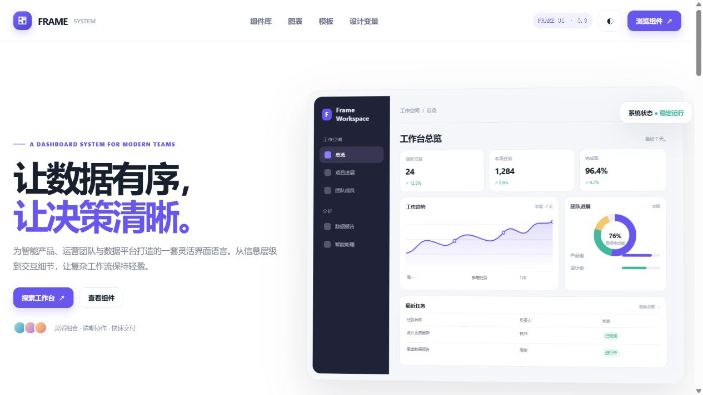

# Frame Dashboard UI

一份原创的中文仪表盘设计系统展示站点，参考 BoardUI 中文展示页的页面结构与交互方向重新设计。品牌、文字、配色、样例数据与组件呈现均为独立实现。

**线上预览：** [Frame Dashboard UI](https://boardui-dashboard-studio.wuwenlong1985123.chatgpt.site)



## 页面内容

- 响应式仪表盘首屏：导航、指标卡、趋势图、团队进度和最近任务。
- 组件样例：指标卡、按钮、搜索框、进度条、状态标签、列表与通知。
- 可交互的组件分类筛选。
- 可切换趋势图与柱状图、7 天与 30 天视图。
- 深色外观切换。
- 设计变量和多种工作区模板示例。

## 本地预览

无需依赖安装或构建，打开 `index.html` 即可。也可在仓库根目录运行：

```powershell
python -m http.server 8000 --directory boardui-replica
```

然后访问 `http://localhost:8000/`。

## 方法说明

[Craft Anything](https://github.com/storytold/craft-anything) 0.3.0 通过 clean-room 模式采集了目标页的访客可见布局、状态和多屏宽截图。该工具生成代码的代理无法访问其项目工作区，故最终页面由 Codex Sites 独立实现。没有复用 BoardUI 的源码、商标、图片或原文。

此页面为静态演示，图表与数据都是本地示例，不连接真实业务服务。
